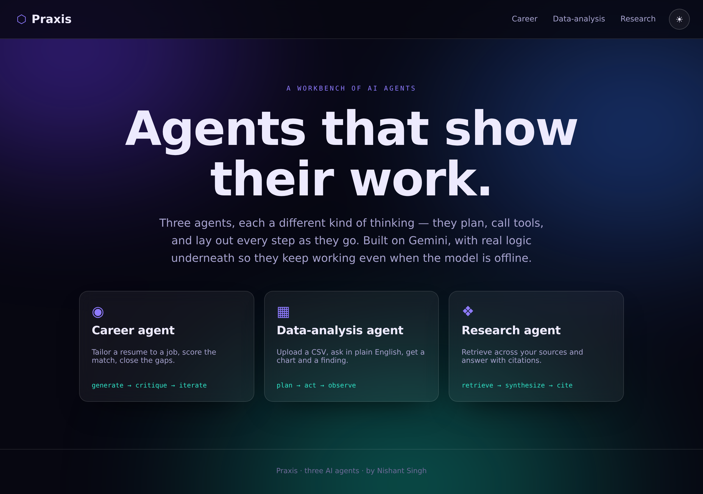
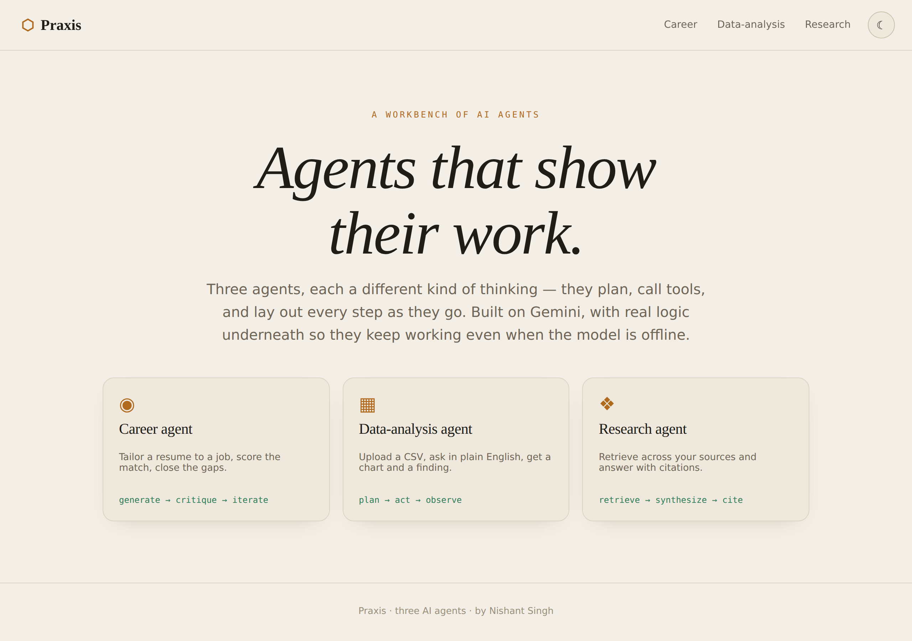
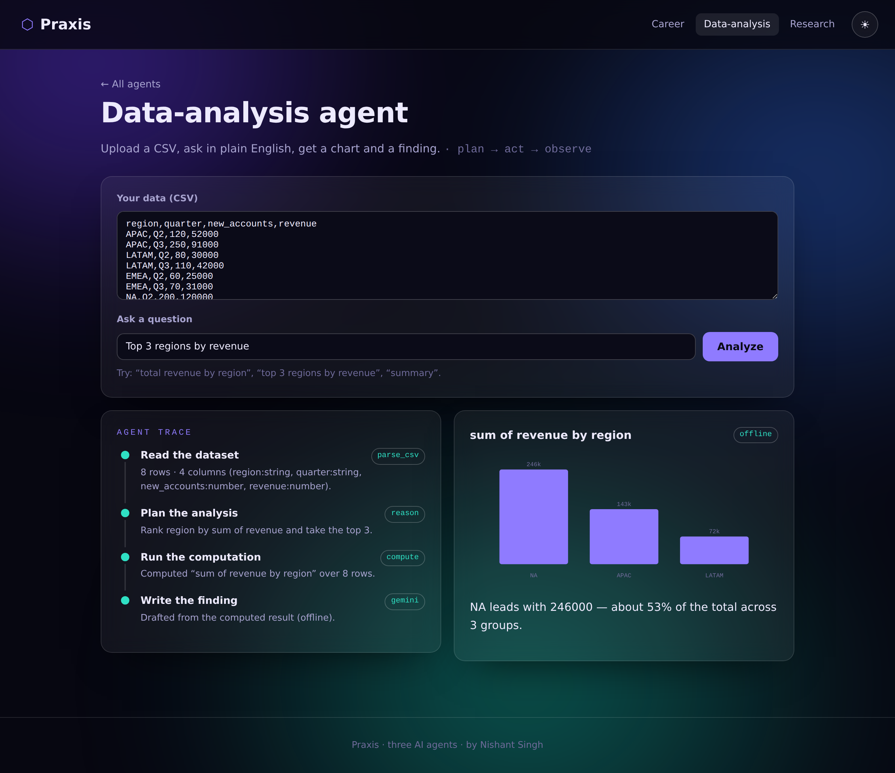
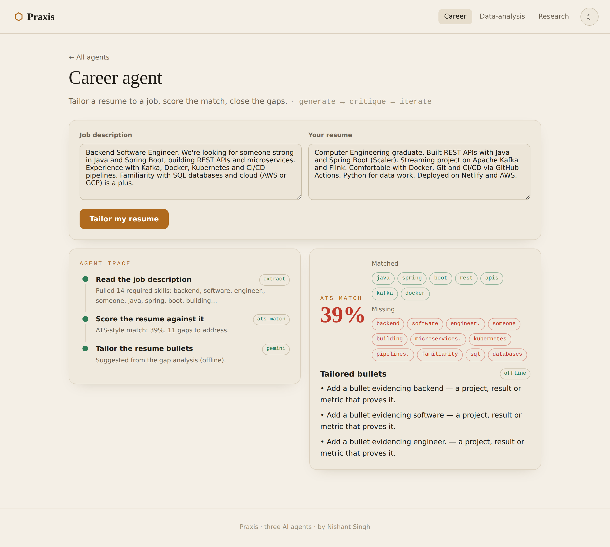
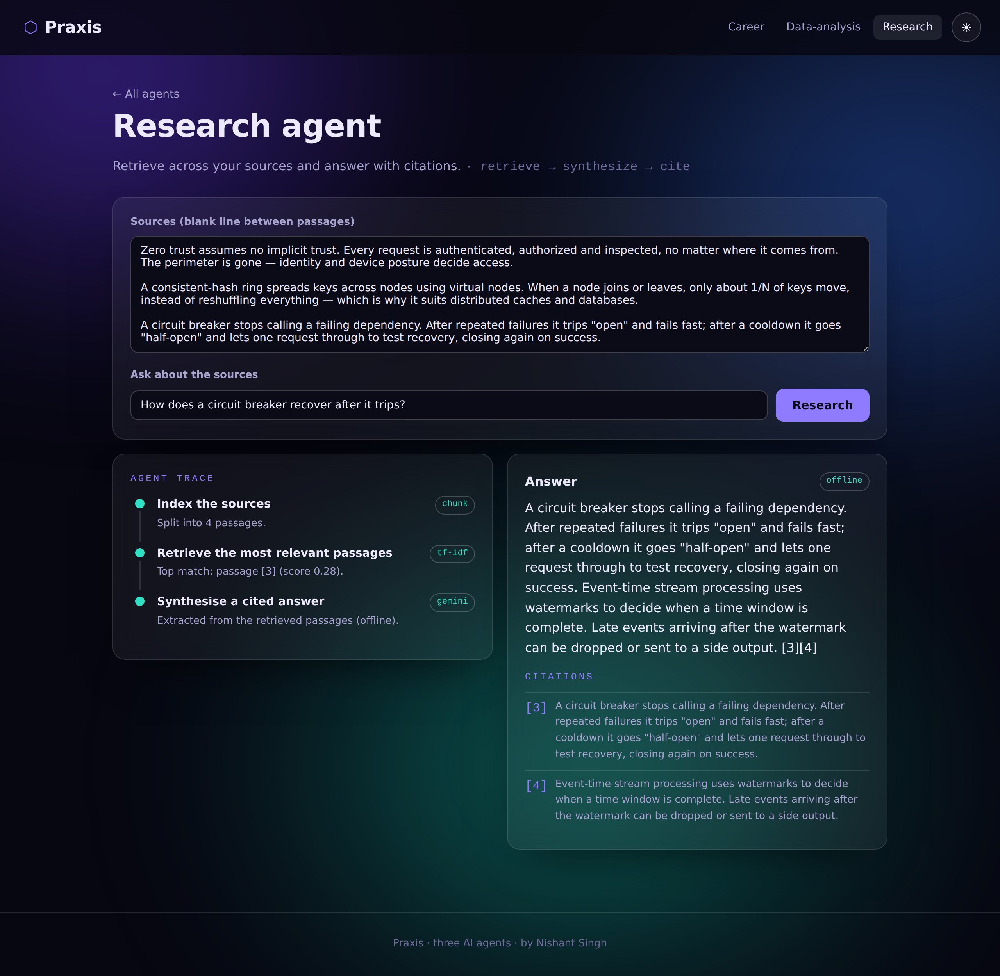

# Praxis

**A workbench of three AI agents that show their work.** Each agent plans, calls tools, and lays out every step as it runs. They're built on Gemini — but with real logic underneath (analysis, scoring, retrieval), so they keep working even when the model is offline or the free tier is busy. Switch between a warm editorial light theme and a glass-neon dark theme.

**Live:** https://praxis-nishant.netlify.app &nbsp;·&nbsp; **Author:** [Nishant Singh](https://nishant-singhaa0240274.netlify.app)




## The three agents

Each is a different agent *pattern*, so together they show range:

### Data-analysis agent — *plan → act → observe*
Paste a CSV, ask in plain English. It reads the data and infers column types, **plans** which operation answers the question, **runs the computation**, and **writes the finding** with a chart. The planning and computation are deterministic; the model only writes the two-sentence narrative.



### Career agent — *generate → critique → iterate*
Paste a job description and your resume. It extracts the required skills, scores your resume against them (an **ATS-style keyword match**, with matched/missing shown), then tailors bullets to close the gaps.



### Research agent — *retrieve → synthesize → cite*
Paste sources and ask a question. It chunks them, **retrieves** the most relevant passages with **TF-IDF cosine similarity**, and synthesizes a **cited** answer. Real RAG retrieval, no embeddings service required.



## Why "shows its work"

Every agent renders its plan and tool calls as a live trace — `parse_csv`, `reason`, `compute`, `tf-idf`, `ats_match`, `gemini` — so you can see it *think*, not just answer. That's the difference between an agent and a chatbot.

## The model layer is optional

The browser does the real work (parsing, planning, scoring, retrieval). The backend is one thin Netlify Function (`/api/generate`) that proxies Gemini for the written layer. If `GEMINI_API_KEY` is unset, the free tier is busy, or the call fails, each agent falls back to a deterministic version and tags the output `offline`. **The demo always works.**

## Theming

One design system, two themes, toggled live and remembered per visitor:
- **Light** — warm editorial: Fraunces italic display, paper tones, amber accents.
- **Dark** — glass-neon: Space Grotesk, an animated aurora, translucent glass panels.

## Tech stack

TypeScript everywhere · React 18 + Vite · Netlify Functions (Node 22) · Gemini (free tier, optional) · hand-built SVG charts · no UI or charting library.

## What it demonstrates

Gen-AI and ML coursework put into working agents: the agentic plan/act loop, RAG retrieval, prompt design with graceful fallback, and real client-side ML-adjacent logic (TF-IDF, keyword scoring, data analysis) — from the Stanford/DeepLearning.AI ML Specialization, IBM Data Science, Google & AWS Gen-AI, and Cisco "Apply AI" tracks.

## Run it

```bash
npm install
npm run build
npx netlify dev          # http://localhost:8888
```

| Variable | Required | What it does |
|---|---|---|
| `GEMINI_API_KEY` | No | Turns on the model-written layer (free tier, no billing). Without it, every agent uses its deterministic fallback. |

## Tests

```bash
npm test          # 37 checks
npm run typecheck # strict TypeScript
```

- **Data** — CSV parsing and type inference, rule-based planning, aggregation/top-N/summary/trend, the deterministic narrative.
- **Career** — keyword extraction, ATS-style scoring (a strong resume scores high, an off-target one low), gap detection.
- **Research** — chunking and TF-IDF retrieval ranking the right passage first.
- **Backend** — the endpoint degrades to `fallback` with no key.

CI runs typecheck, tests and build on every push.

## Deploy on Netlify

Build command `npm run build`, publish directory `dist`. The function is auto-detected. Optionally add `GEMINI_API_KEY` under Site settings → Environment variables (free tier is fine; no billing needed).

## License

MIT © 2026 Nishant Singh.
